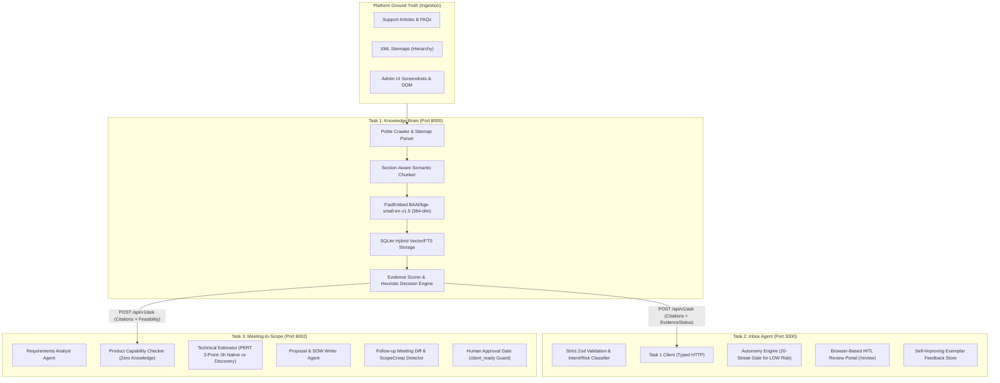

# System Architecture & Technical Design Document

## 1. Problem Framing (Why Before What)

Technical consultancies specialized in vertical SaaS platforms—such as Brilliant Directories—face two severe operational bottlenecks:
1. **Asymmetric Product Knowledge & Hallucination Risk**: Vertical SaaS platforms have hundreds of built-in settings, admin toggles, and add-ons. Junior consultants and generalist LLMs frequently hallucinate custom engineering scopes for features that exist out-of-the-box (e.g., estimating 40 hours for recurring billing when Stripe is natively supported in admin settings), or conversely, quote $0 for features requiring external webhooks and custom API wrappers.
2. **Operational Silos Between Client Touchpoints**: Client interactions arrive through disparate channels: unstructured email support tickets and rambling scoping meetings. Without a shared, grounded source of platform truth, support agents draft inaccurate replies, while solutions architects write inconsistent Statements of Work (SOWs) with colliding requirement IDs, unaddressed scope creep, and untracked client budget/timeline shifts.

To solve this, we architected a unified, three-tier ecosystem anchored by an immutable single source of truth:
- **Task 1 (Knowledge Brain)**: Converts unstructured documentation, sitemaps, and UI screenshots into an authoritative, citation-grounded product memory.
- **Task 2 (Inbox Agent)**: Provides guardrailed, autonomous client communications with Human-in-the-Loop (HITL) safety gates that self-improve through human edits.
- **Task 3 (Meeting-to-Scope)**: A multi-agent orchestration pipeline translating chaotic conversational meeting transcripts into formal, version-controlled SOWs with deterministic follow-up diffing.

---

## 2. Core Architecture & Inter-Service Connectivity

Task 1 is the **sole source of product truth**. Tasks 2 and 3 duplicate zero platform knowledge, delegating all capability and feasibility lookups to Task 1 via typed REST APIs.

---

## 3. Component Deep Dive

### 3.1 Task 1: The Self-Evolving Knowledge Brain
- **Section-Aware Chunking**: Technical documentation cannot be split arbitrarily by character counts without losing section headings, admin paths, and context. Our crawler breaks documents by Markdown/HTML header hierarchies (`##`, `###`), preserving full DOM path breadcrumbs (`Finance > Payment Gateways > Stripe`).
- **Semantic Embeddings without Heuristic Fakes**: Instead of pseudo-embeddings (hashed n-gram vectors), we deploy `fastembed` running `BAAI/bge-small-en-v1.5` generating real 384-dimensional dense semantic vectors. If embedding dimensions drift, automatic table schema migration and chunk re-indexing execute cleanly.
- **Heuristic Evidence Scoring**: Retrieval answers are scored into four deterministic tiers using an uncalibrated heuristic evidence classifier:
  - `STRONG` (Score >= 0.70): Explicit documentation found with matching section headings and high semantic similarity.
  - `PARTIAL` (0.45 <= Score < 0.70): Related topics found but exact technical workflow requires verification.
  - `INSUFFICIENT` (0.0 < Score < 0.45): Distant topic mentions without actionable guidance.
  - `NONE` (Score == 0.0): Zero indexed citations.
- **Sitemap Deletion Safety**: When partial sitemap indices fail over HTTP, the crawler distinguishes between genuine article deletions and network failures (`complete == true`), preventing disastrous database wipes.

### 3.2 Task 2: The Autonomous Inbox Agent
- **Risk-Gated Autonomy Engine**: Full autonomy is never granted globally. Every interaction is partitioned into a tuple: `(intent, riskLevel, productArea)`.
  - Only `LOW` risk kinds (e.g., standard platform inquiries) can ever enter an autonomous state.
  - `HIGH`, `CRITICAL`, or `MEDIUM` risk kinds (financial refund disputes, account security breaches, custom code bugs) **strictly require human review**, even after 100 consecutive approvals.
- **The 20-Consecutive-Approval Rule**: A `LOW`-risk kind enables auto-send only after **20 consecutive approvals without human edits** (`wasUnchanged == true`). A single edit or rejection resets the streak to 0.
- **Self-Improving In-Context Learning**: When human reviewers edit a proposed draft, the diff is preserved in a structured exemplar store. Follow-up drafts for that kind dynamically pull the top few-shot exemplars, demonstrating measurable tone and constraint adherence without expensive fine-tuning.

### 3.3 Task 3: The Multi-Agent Meeting-to-Scope Pipeline
- **Zero-Knowledge Capability Classifier**: The deterministic classifier contains **no hardcoded feature lists**. It queries Task 1 dynamically:
  - Explicit native admin configuration -> `NATIVE` (0.0 custom dev hours).
  - Explicit native base + client custom extension -> `PARTIAL` (custom styling/glue hours only).
  - Explicit Task 1 developer endpoint / custom webhook requirement -> `CUSTOM` (full custom dev hours).
  - Ambiguous / unverified evidence -> `UNKNOWN` (allocated to Discovery Hours, $0 custom dev).
- **PERT Three-Point Estimation**: Every custom and discovery requirement is estimated via PERT:
  $$	ext{Expected Hours} = \frac{O + 4M + P}{6}$$
- **Deterministic Follow-up Diff Engine**: When follow-up meeting transcripts arrive, new requirements inherit stable monotonically increasing IDs (`REQ-04`, `REQ-05`). Changes are categorized into:
  - `NEW`: Newly requested features.
  - `CHANGED`: Updated constraints with preserved acceptance criteria (e.g., "one-way only and new members").
  - `REMOVED`: Explicitly canceled client features.
  - `OUT_OF_SCOPE`: Client requests rejected or deferred.
- **Lightweight Structured Version History**: Each scope snapshot records requirement states, custom/discovery hour totals, open questions, and human approval metadata without external database dependencies.
- **Mandatory Human Approval Gate**: SOWs remain watermarked `PENDING HUMAN APPROVAL` and cannot be marked `client_ready` until approved by an authenticated reviewer.

---

## 4. Key Design Decisions & Features Intentionally Dropped

| Candidate Feature | Decision | Engineering Rationale |
| :--- | :---: | :--- |
| **Distributed Task Queue (Celery/RabbitMQ)** | **DROPPED** | Unnecessary operational overhead for a 2-day capstone. Async Python (`asyncio`) and Node event loops provide high throughput without external message broker failure modes. |
| **Heavy Graph Framework (LangGraph/CrewAI)** | **DROPPED** | Complex abstractions introduce opaque state machines, serialization bloat, and difficult debugging. A lightweight, functional pipeline with Pydantic typed contracts is 100% explainable in a 30-minute code review. |
| **Fine-Tuned LLM Models** | **DROPPED** | Fine-tuning creates stale weights as SaaS documentation evolves daily. Real-time RAG against Task 1 coupled with in-context few-shot learning delivers zero-drift accuracy at trivial cost. |
| **Global Autonomy Flag** | **DROPPED** | Dangerous in production. Granular partitioning by `(intent, risk, productArea)` prevents a streak on easy billing FAQs from auto-sending custom legal contract replies. |
| **Hashed N-Gram Embeddings** | **DROPPED** | Lexical hashing cannot capture semantic synonyms (e.g. "payment gateway" vs "credit card processing"). Replaced with learned FastEmbed dense vectors. |

---

## 5. Model Selection & Justification

We configure Anthropic Claude models with deterministic offline fallbacks:
- **Text Reasoning Default (`claude-haiku-5-5`)**:
  - **Rationale**: Selected as the default text model for lightweight inference, structured JSON output generation, and cost-effective triage across high-volume email classification and requirement parsing tasks.
- **Vision Default (`claude-sonnet-5-5`)**:
  - **Rationale**: Configured for multimodal vision analysis where UI layout understanding and screenshot transcription of admin dashboards are required.
- **Zero-Key Deterministic Fallback**:
  - **Rationale**: If `ANTHROPIC_API_KEY` is not provided in the environment, the entire system falls back to deterministic rule engines, semantic vector search, and heuristic parsers, ensuring tests, local evaluations, and CI/CD pipelines run reliably offline without external API dependencies.
- **Corpus & Heuristic Scoring Limitations**:
  - Task 1 operates under a bounded 25-page initial bootstrap index from the Brilliant Directories Solution Center. Evidence scores use an uncalibrated heuristic scoring engine based on hybrid search overlap and term coverage. Third-party integrations (e.g., external CRMs like HubSpot) can retrieve semantically related Developer Hub/API pages, resulting in partial heuristic scores (`evidence_score=0.609`, `PARTIAL`, `is_known=true`). Task 3 independently enforces capability checks to allocate unverified or third-party scopes to discovery hours rather than assuming native support.

---

## 6. Security & Prompt-Injection Strategy

1. **Strict Input Sanitization & Indirect Injection Defense**:
   - Customer emails and transcripts are treated as untrusted text.
   - Text inputs are strictly separated from system instructions via distinct role blocks and XML delimiters (`<email_body>`, `<meeting_transcript>`).
   - Task 2 incorporates an explicit prompt injection classifier scanning for jailbreaks, instruction overrides (`Ignore previous instructions`), and roleplay attempts.
2. **HTML Entity Encoding in HITL UI**:
   - The Task 2 review UI (`/review`) uses explicit character-level entity encoding (`&`, `<`, `>`, `"`, `'`) before rendering customer emails or proposed drafts, preventing Stored XSS attacks.
3. **Task 1 Evidence Boundary**:
   - Task 3 capability decisions are restricted exclusively to official citations. Even if a transcript prompt attempts to claim "Brilliant Directories natively supports quantum AI", Task 1 returns `NONE` citations, forcing the pipeline into `UNKNOWN`.

---

## 7. Self-Improvement & Continuous Learning Strategy

Instead of brittle model fine-tuning, the platform self-improves through two closed-loop mechanisms:
1. **Human Review Feedback Loop (Task 2)**:
   - When specialists edit drafts in the review dashboard, the system logs the pair `(originalDraft, finalEditedReply, reviewerNotes)`.
   - On future client inquiries for that specific kind, the `FeedbackStore` injects the latest positive exemplars into the system context. Evaluation benchmarks verify that version `v2_feedback_enhanced` demonstrates a **100% feedback incorporation rate** over `v1_baseline`.
2. **24-Hour Autonomous Sitemap Synchronization (Task 1)**:
   - An asynchronous background worker capability is implemented in Task 1 to poll the Brilliant Directories XML sitemap index every 24 hours.
   - When enabled (`ENABLE_BACKGROUND_SYNC=true`), new or updated articles are extracted and re-embedded into the vector database, while complete sitemaps allow safe detection of deleted articles without risking mass deletion on partial network errors.
   - In the default local demo and Docker evaluation environment, this background worker is intentionally disabled (`ENABLE_BACKGROUND_SYNC=false`) to ensure deterministic test execution and avoid unsolicited background network traffic.

---

## 8. What I Would Build Next

1. **Interactive Client Client-Portal for SOW Revisions**: Expose a client-facing web interface where stakeholders can click to accept or reject individual `CHANGED` or `OUT_OF_SCOPE` line items, triggering instant automatic PERT recalculations.
2. **Live Meeting Audio Ingestion (Whisper/AssemblyAI)**: Stream live Zoom/Google Meet audio directly into the Task 3 pipeline with real-time speaker diarization and instant on-screen platform capability alerts.
3. **Automated Brilliant Directories Sandbox Provisioning**: Connect Task 3's final SOW to the Brilliant Directories Developer API to automatically spin up a staging directory with the exact native settings enabled.
