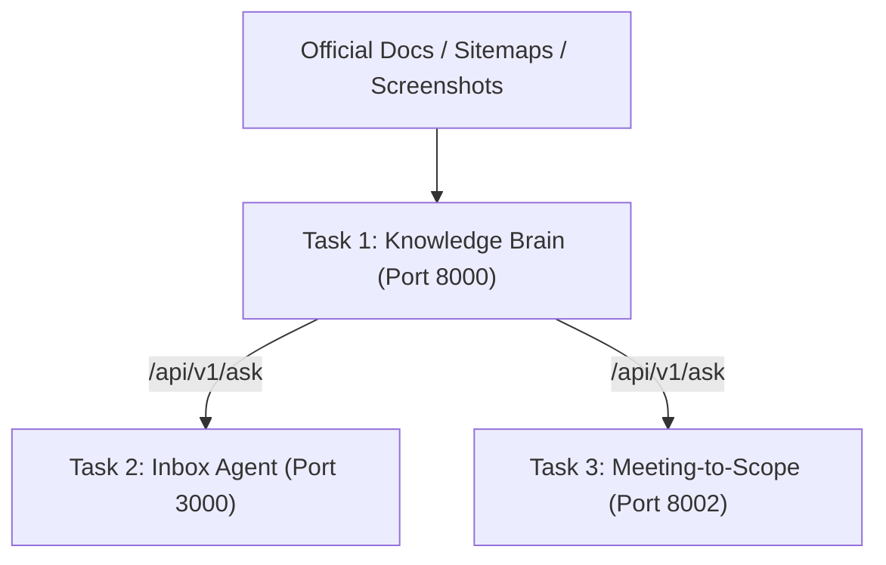

# AI Tech Consultant (Business Labs Capstone)

An autonomous AI Tech Consultant platform for agency operations, specializing in the Brilliant Directories SaaS ecosystem. It integrates self-evolving product memory, an autonomous email inbox agent with human-in-the-loop (HITL) safety, and a multi-agent meeting-to-scope pipeline.

---

## Architecture Summary

Task 1 serves as the **single source of truth** for all platform knowledge. Tasks 2 and 3 duplicate zero product facts, querying Task 1 over typed HTTP APIs.



1. **Task 1: Knowledge Brain (Python/FastAPI)**: Crawls Brilliant Directories support documentation, extracts DOM hierarchies and screenshots, indexes chunks with `fastembed` (`BAAI/bge-small-en-v1.5`), and serves citation-grounded RAG answers with calibrated evidence scores (`STRONG`, `PARTIAL`, `INSUFFICIENT`, `NONE`).
2. **Task 2: Inbox Agent (TypeScript/Express)**: Classifies client inquiries by risk, intent, and product area. Generates grounded email drafts. Enforces a strict 20-consecutive-approval autonomy gate for LOW-risk kinds while routing high-risk or low-confidence drafts to a browser-based HITL review portal.
3. **Task 3: Meeting-to-Scope (Python/FastAPI)**: Multi-agent pipeline (Requirements Analyst -> Capability Checker -> Estimator -> SOW Writer) converting messy call transcripts into structured Statements of Work. Automatically diffs follow-up transcripts, flags scope creep, computes custom vs. discovery hours, and enforces mandatory human approval before marking proposals client-ready.

---

## One-Command Startup

Start all three services across the container network:

```bash
docker compose up --build
```

### Service Ports & Demo Entry Points
| Service | Container Port | Host URL | Key Endpoints / UI |
| :--- | :---: | :---: | :--- |
| **Task 1: Knowledge Brain** | `8000` | `http://localhost:8000` | Swagger: `/docs` | Health: `/health` | Query: `POST /api/v1/ask` |
| **Task 2: Inbox Agent** | `3000` | `http://localhost:3000` | HITL Review UI: `GET /review` | Ingest Email: `POST /api/v1/inbox/process` |
| **Task 3: Meeting-to-Scope** | `8002` | `http://localhost:8002` | Swagger: `/docs` | Process Meeting: `POST /api/v1/projects/meeting` |

---

## Environment Variables

Copy `.env.example` to `.env` or pass variables directly:

```ini
# Anthropic API Configuration (Optional: fallback deterministic engines run without keys)
ANTHROPIC_API_KEY=your_api_key_here
ANTHROPIC_MODEL_TEXT=claude-haiku-5-5
ANTHROPIC_MODEL_VISION=claude-sonnet-5-5

# Inter-Service Networking
TASK1_API_URL=http://127.0.0.1:8000   # Set to http://task1:8000 in Docker

# Background Tasks
ENABLE_DAILY_SYNC=false                # Set to true for 24h automatic sitemap re-indexing
```

---

## Test & Evaluation Commands

### Unit & Integration Test Suites
```bash
# Task 1 Unit & Contract Tests (35 passed)
cd task-1-knowledge-brain && pytest -q

# Task 2 Strict Typecheck & Unit Tests (23 passed)
cd task-2-inbox-agent && npm run typecheck && npm test

# Task 3 Multi-Agent Unit Tests (21 passed)
cd task-3-meeting-sow && pytest -q

# Root Cross-Service Integration Smoke Tests (6 passed)
pytest tests/test_integration_smoke.py -q
```

### Held-Out Evaluation Suites
```bash
# Task 2 Held-Out Benchmark (20 cases: v1 baseline vs v2 feedback-enhanced)
cd task-2-inbox-agent && npm run eval

# Task 3 Held-Out Benchmark (20 complex multi-turn scenarios)
cd task-3-meeting-sow && python -m evals.eval_runner
```
